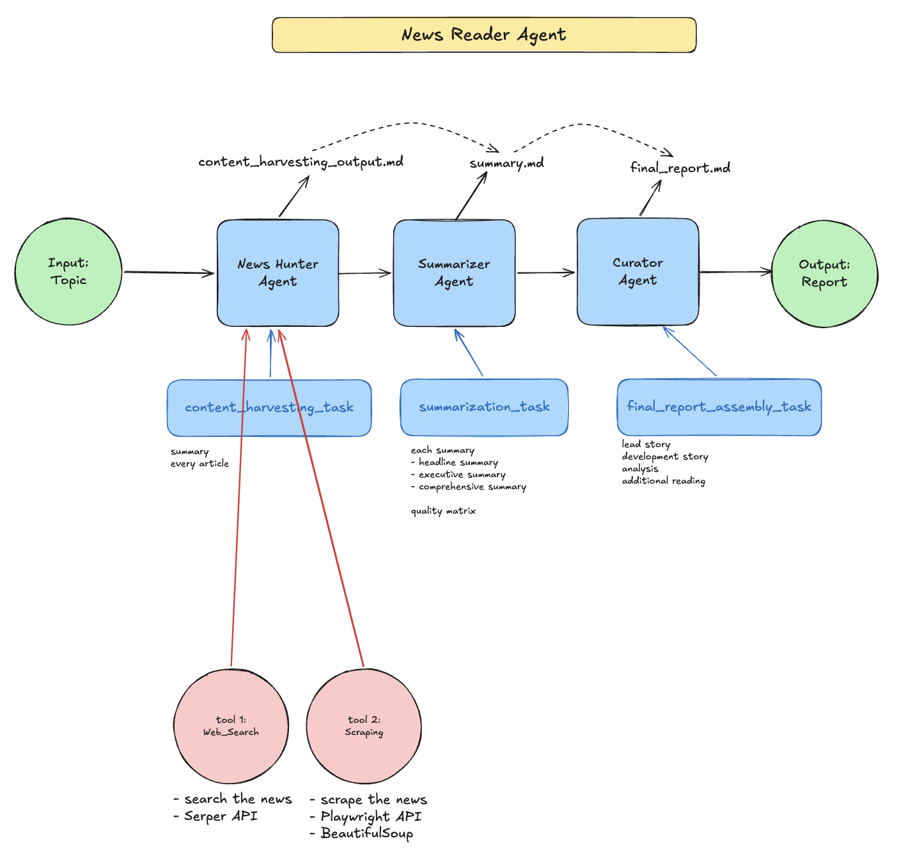

# News Reader Agent

A CrewAI crew that turns a topic into a news briefing. Three agents search, scrape, summarize, and edit the result into a report.

<p align="center">
  
</p>

## How it runs

1. **News Hunter** searches the web with the Serper API, then scrapes each article with Playwright and BeautifulSoup. It writes `output/content_harvesting_output.md`.
2. **Summarizer** turns each article into a headline, an executive summary, and a comprehensive summary. It writes `output/summary.md`.
3. **Curator** assembles the lead story, developments, analysis, and further reading. It writes `output/final_report.md`.

Pass the topic when the crew starts:

```python
NewsReaderAgent().crew().kickoff(inputs={"topic": "your topic"})
```

## Setup

Requires Python 3.13+ and [uv](https://docs.astral.sh/uv/).

```bash
uv sync
uv run playwright install chromium
```

Create a `.env` file in the project root:

```bash
OPENAI_API_KEY=your_openai_key
SERPER_API_KEY=your_serper_key
```

Then run:

```bash
uv run python main.py
```
